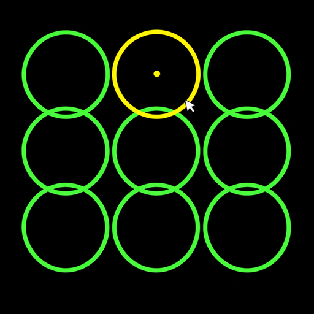

# NodeLock

Lock an attachment node in Kitten Space Agency's vehicle editor and keep your part seated there while you rotate it.

## Controls

1. Pick up a part and hover near an attachment node. Its ring turns yellow.
2. Tap **Tab** to lock the node.
3. Rotate with **WASD/QE**; hold **Shift** for fine rotation. NodeLock switches to a compatible connector on the part, skipping sides without one. If no alternative exists, the part keeps its orientation.
4. Click to attach, or tap **Tab** again to unlock.

Yellow marks the destination node; cyan marks the carried part's connector. If a change of context clears the lock, tap Tab to resume placement.

## Installation

[Download the 0.1.1 build](release/0.1.1/NodeLock-0.1.1.zip) or view [published releases](https://github.com/DymndLab/NodeLock/releases).

NodeLock 0.1.1 targets **KSA 2026.11.25.5949** and **StarMap 0.5.4+**. Build and native probes verified on Windows. The Windows Borea editor smoke test received a positive user report. Symmetry inheritance and save/reload are still unconfirmed. Linux and macOS are unverified. Other game builds are not supported by this release.

Close KSA, extract the `NodeLock` folder into your active profile's `mods` folder, enable it in the mod manifest/manager, and launch with StarMap. In Borea, use the selected instance's mods folder. Load NodeLock after Core and after PurrlineTessera if installed.

## Bay compatibility

Included connector adjustments let small and medium radial batteries, the two stock spherical RCS tanks, and Tessera sphere mounts attach to smaller bay nodes. PurrlineTessera is optional and is not included.

[Build instructions](docs/BUILDING.md) · [Report an issue](https://github.com/DymndLab/NodeLock/issues) · [MIT license](LICENSE)
